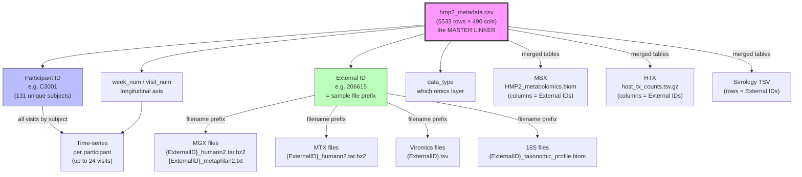

# HMP2 / IBDMDB Dataset — Complete Guide

> **Reference:** Lloyd-Price J, et al. (2019). *Multi-omics of the gut microbial ecosystem in inflammatory bowel diseases.* **Nature**, 569, 655–662. [doi:10.1038/s41586-019-1237-9](https://doi.org/10.1038/s41586-019-1237-9)

---

## What Is IBDMDB / HMP2?

The **Inflammatory Bowel Disease Multi-omics Database (IBDMDB)** is the data output of **iHMP2** (Integrative Human Microbiome Project, Phase 2). It is the most comprehensive longitudinal multi-omics study of the gut microbiome in IBD to date.

| Property | Value |
|---|---|
| Study design | Longitudinal (up to 1 year, biweekly sampling) |
| Participants | **131 unique subjects** |
| Diagnoses | Crohn's disease (CD), Ulcerative colitis (UC), non-IBD controls |
| Total samples | **5,533 rows** in metadata (across all omics layers) |
| Clinical sites | Cedars-Sinai, MGH, Cincinnati, MGH Pediatrics, Emory |
| Metadata columns | **490** columns per sample |
| Data portal | [ibdmdb.org](https://ibdmdb.org) → data hosted on Globus |

---

## Cohort Overview

```
131 participants
├── Crohn's Disease (CD)   → 2,682 samples (48%)
├── Ulcerative Colitis (UC)→ 1,506 samples (27%)
└── Non-IBD Controls       → 1,345 samples (24%)
```

**Study timeline:** Week -4 (baseline/screening) through Week 57 (~14 months follow-up)

**Clinical sites:**
| Site | Samples |
|---|---|
| Cincinnati Children's | 1,765 |
| MGH (Mass General Hospital) | 1,499 |
| Cedars-Sinai | 1,357 |
| MGH Pediatrics | 701 |
| Emory | 211 |

---

## Data Layers (Omics Types)

The dataset spans **11 distinct data modalities**, each stored separately:

| Data Type | Abbrev | Samples | Description | Sample Source |
|---|---|---|---|---|
| Metagenomics | MGX | 1,638 | Microbial species + gene function (HUMAnN2/MetaPhlAn2) | Stool |
| Metatranscriptomics | MTX | 835 | Active microbial gene expression | Stool |
| Viromics | MVX | 703 | Viral community profiles | Stool |
| Metabolomics | MBX | 546 | LC-MS fecal/serum metabolites | Stool/serum |
| Methylome | METH | 449 | Host DNA methylation | Blood |
| Proteomics | PROT | 450 | Microbial protein abundances | Stool |
| Host transcriptomics | HTX | 252 | Mucosal biopsy RNA-seq | Biopsy |
| Serology | SER | 210 | ELISA antibody panels | Serum |
| 16S (stool) | 16S | 180 | Amplicon OTU profiles | Stool |
| 16S (biopsy) | 16S-B | 178 | Amplicon OTU profiles | Biopsy |
| Host genome | HG | 92 | WGS of host DNA | Blood |

---

## Directory Structure (Local)

```
data/hmp2/
│
├── metadata/
│   └── hmp2_metadata_2018-08-20.csv    ← THE MASTER LINKER (490 cols × 5533 rows)
│
├── mgx/                                 ← Metagenomics (Whole Genome Shotgun)
│   ├── func_profiles/
│   │   └── {ExternalID}_humann2.tar.bz2  (per-sample HUMAnN2 output)
│   └── tax_profiles/
│       └── {ExternalID}_metaphlan2_profile.txt
│
├── mtx/                                 ← Metatranscriptomics
│   ├── func_profiles/
│   └── tax_profiles/
│
├── mbx/                                 ← Metabolomics
│   ├── HMP2_metabolomics.biom           ← MERGED table (all samples)
│   ├── HMP2_metabolomics_w_metadata.biom.gz
│   └── C18n_Metabolites_ID_AfterPublication_2021-05-17.xlsx
│
├── htx/                                 ← Host Transcriptomics (biopsy RNA-seq)
│   ├── host_tx_counts.tsv.gz            ← MERGED count matrix
│   └── host_tx_counts.biom.gz
│
├── serology/
│   └── HMP2_serology_Compiled_CLIA_lab_results_2.tsv
│
├── viromics/                            ← Viromics (MVX)
│   └── tax_profiles/
│       └── {ExternalID}.tsv
│
└── 16s/                                 ← 16S Amplicon
    └── tax_profiles/
        └── {ExternalID}_taxonomic_profile.biom
```

---

## The Master Metadata File — Anatomy

The file `hmp2_metadata_2018-08-20.csv` is the **single source of truth** that links all omics layers. Every row = one assay run on one sample.

### Primary Linking Keys

| Column | Role | Example |
|---|---|---|
| `External ID` | **Primary sample ID** — matches filenames in all omics subdirs | `206615` |
| `Participant ID` | Subject-level ID — links all samples from one person | `C3001` |
| `site_sub_coll` | Site + subject + collection event ID | `C3001CSC1` |
| `data_type` | Which omics layer this row describes | `metagenomics` |
| `week_num` | Weeks from baseline (-4 to 57) | `2.0` |
| `visit_num` | Sequential visit number | `1` |
| `diagnosis` | IBD group | `CD` / `UC` / `nonIBD` |
| `biopsy_location` | For HTX/16S-biopsy samples | `Rectum` / `Ileum` |

### Column Groups (490 total)

```
metadata columns (490 total)
│
├── Identification & tracking (8 cols)
│   External ID, Participant ID, site_sub_coll, data_type,
│   week_num, visit_num, Project, Research Project
│
├── Sequencing QC (14 cols)
│   reads_raw, reads_filtered, reads_qc_fail, reads_human,
│   reads_ribosomal, reads_viral, PDO Number, LCSET, ...
│
├── Clinical / IBD scores (8 cols)
│   diagnosis, fecalcal_ng_ml, Disease_course, sccai,
│   SES-CD Score, SIBDQ Score, Partial Endoscopy, ...
│
├── Sample tracking / biobank (30 cols)
│   biopsy_location, stool_id, Tube A/B, received_at_Broad,
│   Proteomics received at LBNL, Viromics received at Baylor, ...
│
├── Medication history (22 cols)
│   Antibiotics, Remicade (Infliximab), Humira (Adalimumab),
│   Azathioprine, Mercaptopurine, Prednisone, Cimzia, ...
│
├── Diet & lifestyle (29 cols)
│   Yogurt, Dairy, Vegetables, Fruits, Red/white meat,
│   Alcohol, Sleep quality, Probiotics, ...
│
├── Demographics (6 cols)
│   consent_age, sex, race, Education Level, Occupation,
│   site_name
│
├── Surgical / endoscopy history (~15 cols)
│   Has subject had upper/lower endoscopy, GI-related surgeries,
│   biopsy_location, cholecystectomy, appendectomy, ...
│
└── Patient-reported outcomes / quality of life (~50 cols)
    SIBDQ symptoms, IBD questionnaire, fatigue, nausea,
    sleep, pain, well-being, ...
```

---

## How Everything Is Linked



### The Joining Logic (Python pseudocode)

```python
import pandas as pd

# 1. Load the master metadata
meta = pd.read_csv("data/hmp2/metadata/hmp2_metadata_2018-08-20.csv")

# 2. Each omics type has its own rows in metadata
mgx_meta  = meta[meta['data_type'] == 'metagenomics']
mtx_meta  = meta[meta['data_type'] == 'metatranscriptomics']
mbx_meta  = meta[meta['data_type'] == 'metabolomics']
htx_meta  = meta[meta['data_type'] == 'host_transcriptomics']

# 3. External ID links metadata row → data file
# e.g. External ID "PSM7J1AU" → PSM7J1AU_humann2.tar.bz2 (MGX)
#                              → PSM7J1AU.tsv (Viromics)
#                              → PSM7J1AU_taxonomic_profile.biom (16S)

# 4. Participant ID links all omics for one subject across time
participant_samples = meta[meta['Participant ID'] == 'C3001']
# This gives ALL 11 data types collected from subject C3001 over all visits

# 5. Merged tables (HTX, MBX) have ExternalID as column headers
htx_counts = pd.read_csv("data/hmp2/htx/host_tx_counts.tsv.gz",
                          sep='\t', index_col=0)
# Columns are External IDs → merge with meta on External ID
htx_full = htx_counts.T.merge(meta, left_index=True, right_on='External ID')
```

---

## Per-Sample vs. Merged File Formats

| Layer | Per-sample files | Merged/combined table |
|---|---|---|
| MGX | `{ID}_humann2.tar.bz2`, `{ID}_metaphlan2.txt` | No single merged file on portal |
| MTX | `{ID}_humann2.tar.bz2` | No single merged file on portal |
| MBX | — | `HMP2_metabolomics.biom` |
| HTX | — | `host_tx_counts.tsv.gz` |
| SER | — | `HMP2_serology_Compiled_CLIA_lab_results_2.tsv` |
| 16S | `{ID}_taxonomic_profile.biom` | No single merged file on portal |
| VIR | `{ID}.tsv` | No single merged file on portal |

> [!TIP]
> For MGX and MTX, use `humann2_join_tables` (from the bioBakery toolkit) to merge individual per-sample profiles into a single wide matrix for analysis.

---

## File Format Quick Reference

| Extension | Format | How to read |
|---|---|---|
| `.tsv` / `.tsv.gz` | Tab-separated values | `pd.read_csv(..., sep='\t')` |
| `.csv` | Comma-separated values | `pd.read_csv(...)` |
| `.biom` / `.biom.gz` | BIOM v1/v2 (JSON or HDF5) | `biom.load_table(...)` |
| `.pcl.tsv` | PCL = tab-sep with header metadata rows | Treat first few rows as headers |
| `.tar.bz2` | HUMAnN2 output bundle | `tarfile.open(...)` |
| `.gz` | gzip compressed | Auto-decoded by pandas or `gzip` |
| `.xlsx` | Excel | `pd.read_excel(...)` |

---

## Data Access

| Method | URL / Command |
|---|---|
| **Web portal** | [ibdmdb.org/downloads](https://ibdmdb.org/downloads/) |
| **Globus HTTP** | `https://g-227ca.190ebd.75bc.data.globus.org/ibdmdb/` |
| **Globus transfer** | Collection ID `g-227ca.190ebd.75bc` (best for bulk) |
| **Bioconductor** | `BiocManager::install("HMP2Data")` (R) |
| **Raw reads** | NCBI BioProject [PRJNA398089](https://www.ncbi.nlm.nih.gov/bioproject/PRJNA398089) |
| **Controlled access** | dbGaP (host DNA/RNA): phs001626 |

---

## Downloaded Files (This Project)

> [!IMPORTANT]
> All 8 files successfully downloaded to `data/hmp2/` via Globus HTTP (`g-227ca.190ebd.75bc.data.globus.org`).

| File | Layer | Actual Size | Description |
|---|---|---|---|
| `metadata/hmp2_metadata_2018-08-20.csv` | META | **8.6 MB** | Master 5533×490 metadata table |
| `metadata/anadama_run.log.gz` | META | **11.1 MB** | AnADAMA pipeline provenance log |
| `htx/host_tx_counts.tsv.gz` | HTX | **36.3 MB** | Biopsy RNA-seq count matrix (TSV) |
| `htx/host_tx_counts.biom.gz` | HTX | **0.9 MB** | Same in BIOM format |
| `mbx/HMP2_metabolomics.biom` | MBX | **514 MB** | Stool/serum metabolomics (full BIOM) |
| `mbx/HMP2_metabolomics_w_metadata.biom.gz` | MBX | **138.7 MB** | Metabolomics + embedded metadata (compressed) |
| `mbx/C18n_Metabolites_ID_...xlsx` | MBX | **11 KB** | Metabolite ID annotations (2021 update) |
| `serology/hmp2_serology_Compiled_ELISA_Data.tsv` | SER | **9 KB** | ELISA antibody panel results |

**Total downloaded: ~710 MB**

> [!NOTE]
> MGX, MTX, 16S, and Viromics files are per-sample archives (thousands of files, ~100 GB total). Use product index pages at `ibdmdb.org/downloads/html/products_*.html` to get Globus URLs, or use the Globus CLI/app for bulk transfer to `g-227ca.190ebd.75bc`.

---

## Key Scientific Findings (What to Expect)

1. **Dysbiosis bursts** — IBD patients show episodic microbial instability
2. **Bacteroides/Lachnospiraceae** depletion in active disease
3. **Metabolomics signature** — reduced secondary bile acids, sphingolipids in CD/UC
4. **MTX/MGX decoupling** — transcription ≠ abundance in IBD (expression dysregulation)
5. **Host–microbe interaction** — host HTX correlates with specific microbial species

---

*Dataset guide auto-generated from real metadata analysis (Nov 2026)*
